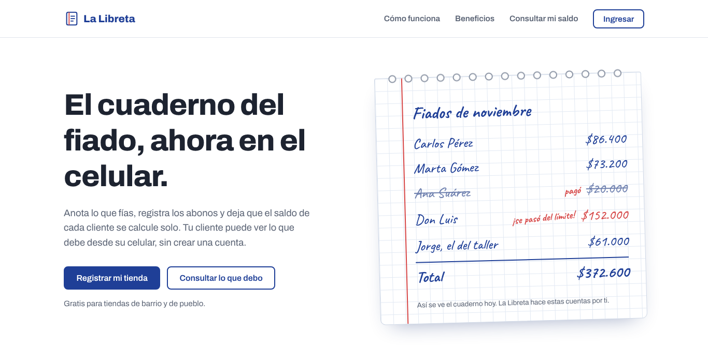
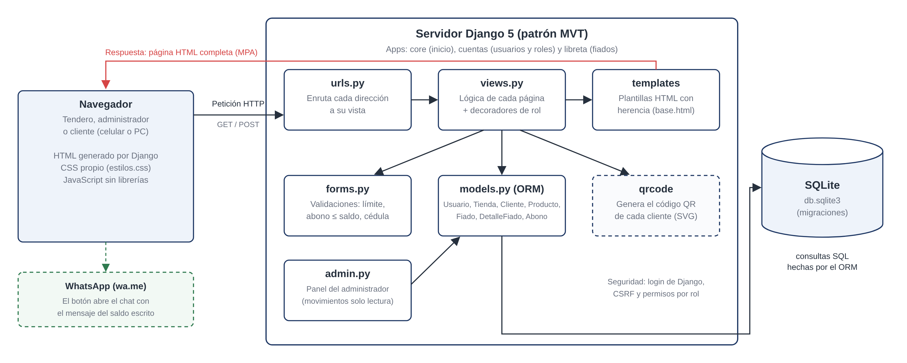
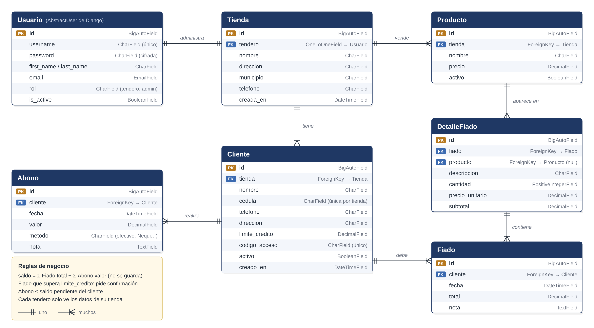
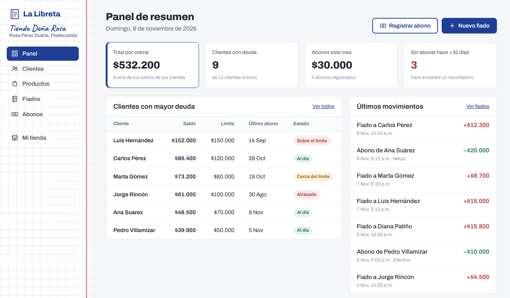
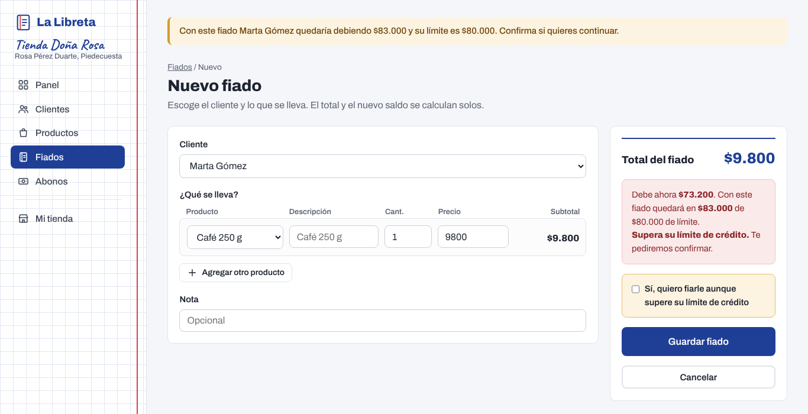
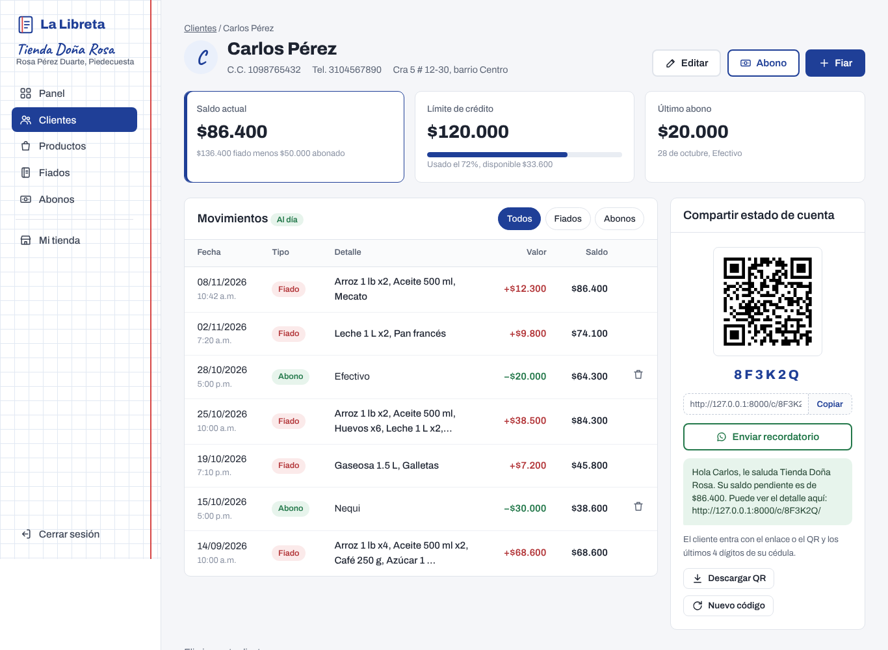
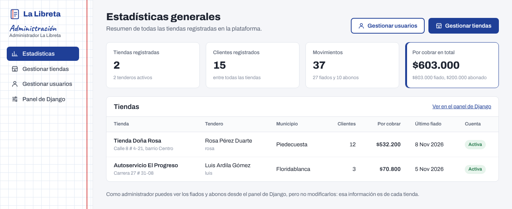
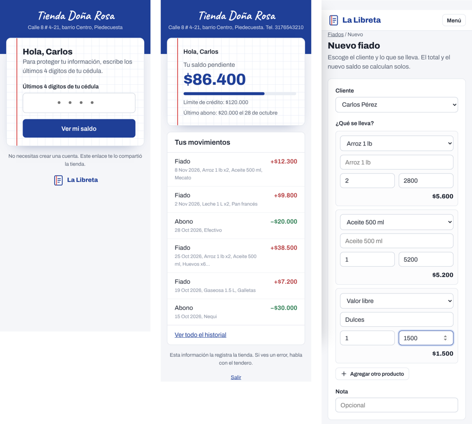

# La Libreta

**El cuaderno del fiado, ahora en el celular.** Aplicación web en Django para que las tiendas de barrio y de pueblo lleven el control de los fiados (ventas a crédito), los abonos y el saldo de cada cliente. El cliente consulta lo que debe desde su celular con un enlace o código QR, sin crear una cuenta.

Proyecto final de **Programación en la Web**, Universidad Industrial de Santander (UIS).

| Código | Integrante |
|---|---|
| 2245502 | Jonathan Steven Torres Duarte |
| 2245503 | Gonzalo Andrés Tarazona Higuera |



## Funcionalidades

- Registro de tenderos (crea el usuario y su tienda), inicio y cierre de sesión.
- CRUD de clientes con límite de crédito, y CRUD de productos con precio.
- Registro de fiados con productos del catálogo o valores libres; subtotales y total automáticos.
- Registro de abonos parciales o totales con método de pago (efectivo, Nequi, Daviplata…).
- Saldo calculado automáticamente (fiados − abonos) y alerta cuando un fiado supera el límite: el tendero debe confirmarlo.
- Estado de cuenta del cliente con el saldo después de cada movimiento.
- Panel de resumen: total por cobrar, clientes con mayor deuda, abonos del mes y clientes sin abonar hace más de 30 días.
- Búsqueda y filtros de clientes (con deuda, atrasados, sobre el límite, archivados).
- Enlace y código QR único por cliente; el cliente entra con los últimos 4 dígitos de su cédula (bloqueo tras 5 intentos fallidos).
- Botón de recordatorio que abre WhatsApp con el mensaje y el saldo ya escritos.
- Estadísticas generales y gestión de tiendas y usuarios para el administrador.

## Roles

| Rol | Qué puede hacer |
|---|---|
| **Administrador** | Ve estadísticas de toda la plataforma; gestiona tiendas y usuarios (activar o desactivar cuentas) desde el panel de Django. Ve fiados y abonos, pero **no puede modificarlos**. |
| **Tendero** | Gestiona sus clientes, productos, fiados y abonos; ve su panel y comparte el estado de cuenta. **Solo ve los datos de su propia tienda.** |
| **Cliente** (sin cuenta) | Entra con su enlace o QR y los últimos 4 dígitos de su cédula. Solo lectura. |
| **Visitante** | Ve la página de inicio y puede registrarse como tendero. |

## Arquitectura

Aplicación **MPA (Multi-Page Application)**: cada acción hace una petición al servidor y Django responde con una página HTML completa, generada con su patrón **MVT** (modelo, vista, plantilla). No usa frameworks de frontend: HTML, CSS propio y un poco de JavaScript sin librerías.



**Tecnologías:** Python 3, Django 5.2 (ORM, autenticación, formularios, panel de administración), SQLite, librería `qrcode`, HTML5, CSS3 y JavaScript.

**Apps del proyecto:**

- `core`: página de inicio.
- `cuentas`: usuario personalizado con rol, registro, ingreso, estadísticas y control de acceso por rol (`decorators.py`).
- `libreta`: modelos del negocio, vistas del tendero y consulta pública del cliente.

## Modelo de datos



## Cómo ejecutarlo

Requisitos: Python 3.10 o superior.

```bash
# 1. Crear y activar un entorno virtual
python -m venv .venv
.venv\Scripts\activate          # Windows
source .venv/bin/activate       # macOS / Linux

# 2. Instalar dependencias
pip install -r requirements.txt

# 3. Crear la base de datos y cargar los datos de prueba
python manage.py migrate
python manage.py cargar_demo

# 4. Iniciar el servidor
python manage.py runserver
```

Abrir <http://127.0.0.1:8000>.

### Usuarios de prueba

Todos con la contraseña **`Libreta2026`**:

| Usuario | Rol | Tienda |
|---|---|---|
| `admin` | Administrador | (todas) |
| `rosa` | Tendera | Tienda Doña Rosa, Piedecuesta (12 clientes) |
| `luis` | Tendero | Autoservicio El Progreso, Floridablanca (3 clientes) |

**Consulta como cliente:** en el inicio escribe el código **`8F3K2Q`** (Carlos Pérez) y los dígitos **`5432`**.

`cargar_demo` se puede ejecutar de nuevo para dejar los datos como al principio.

### Pruebas automáticas

```bash
python manage.py test
```

18 pruebas de las reglas de negocio (saldo, límite de crédito, abono mayor que el saldo, clientes atrasados) y de los permisos por rol (un tendero no ve los clientes de otra tienda, el administrador no puede modificar fiados, bloqueo del PIN, etc.).

## Capturas

| Panel del tendero | Fiado que supera el límite |
|---|---|
|  |  |

| Estado de cuenta | Estadísticas del administrador |
|---|---|
|  |  |

Vista en el celular: consulta del cliente y registro de un fiado.



## Estructura

```
la-libreta/
├── config/            Configuración del proyecto (settings, urls)
├── core/              Página de inicio
├── cuentas/           Usuario con rol, registro, ingreso, estadísticas, permisos
├── libreta/           Modelos, formularios, vistas, admin, pruebas y datos de prueba
├── templates/         Plantillas HTML (base, públicas, tendero, administrador)
├── static/            CSS, JavaScript, fuentes e imágenes
├── docs/              Diagramas y capturas
├── manage.py
└── requirements.txt
```

Las fuentes Archivo y Caveat se incluyen en `static/fonts` bajo la licencia SIL Open Font License.
